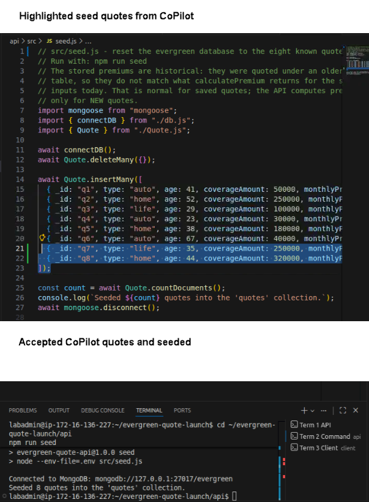

# Copilot Assessment: AI-Assisted Seed Data 

| | |
|---|---|
| **Author** | Shadd Schutte, Delivery Lead |
| **Date** | Wednesday 11-18-2026 |
| **Task** | Use GitHub Copilot for one assembly step, review it, and decide whether to ship it |
| **File** | `api/src/seed.js` |
| **Linked risk** | R6: AI-generated changes break the data contract unnoticed |
| **Outcome** | Accepted and committed after review |

## What we asked Copilot to do

In VS Code, I asked Copilot to **add two more seed quotes to
`api/src/seed.js`, matching the shape of the existing six and the rules
in the database schema (`api/src/Quote.js`)**. The seed script resets
the local `evergreen` database to a known set of quotes for development
and testing.

## What Copilot produced

| Row | Type | Age | Coverage | Monthly premium |
|---|---|---|---|---|
| `q7` | life | 35 | 250,000 | <value from seed.js> |
| `q8` | home | 44 | 320,000 | <value from seed.js> |

Copilot also updated the comment at the top of the file from "six known
quotes" to "eight known quotes", keeping the documentation in step with
the data.

## How I reviewed it

| Check | Result |
|---|---|
| Same fields as the existing rows (`_id`, `type`, `age`, `coverageAmount`, `monthlyPremium`) | Pass |
| Ids continue the sequence (`q7`, `q8`) with no duplicates | Pass |
| Coverage types are ones the schema allows (auto, home, life) | Pass: life and home |
| Ages are realistic adults | Pass: 35 and 44 |
| Values are numbers, not text | Pass |
| No other lines in the file changed except the header comment | Pass |
| The database accepts the rows | Pass: `npm run seed` reported "Seeded 8 quotes into the 'quotes' collection." |

## Which checks would have caught a bad row

| Check | Covers `seed.js`? | When |
|---|---|---|
| TypeScript type-check | No: it only checks the client; `seed.js` is JavaScript in the API | Never |
| Mongoose schema (`Quote.js`) | Yes, every document | Only at runtime, when the seed runs |
| CI tests | No: they test the API routes against a separate test database | Never |

The only automatic safety net for seed data is the database schema, and
only when someone runs the seed. A bad row (an unknown coverage type,
age 12, or a premium written as text) would pass the type-check and CI
and only fail when a developer reseeded. Human review is the real gate.

## Critique

Copilot did well: it copied the existing structure exactly, continued
the id sequence, chose coverage types and ages the schema allows, and
even updated the header comment. What it could not tell me is whether
its premiums are "right": the existing six rows carry historical
premiums from an older rate table, and Copilot gave no indication of
which rate table it used for the new two. That is acceptable for
development seed data, but it is a judgment a person has to make, not
the tool. I would ship these rows, and I did, because I reviewed every
field and the schema accepted them. The lesson for AI-assisted teams:
the tool is fast at matching a pattern; the leader still decides
whether the pattern is correct, and knows which checks would catch it
if it were not.

## Decision and impact

- **Decision:** keep both rows; committed on `delivery/lead`.
- **Impact on the launch:** none to the product. The rows only exist
  where the seed is run, which is the local VM database. The cluster
  database for Friday's demo is not seeded, and CI uses its own clean
  test database.
- **Benefit:** two more realistic quotes, including a higher-coverage
  life quote, for future development testing.