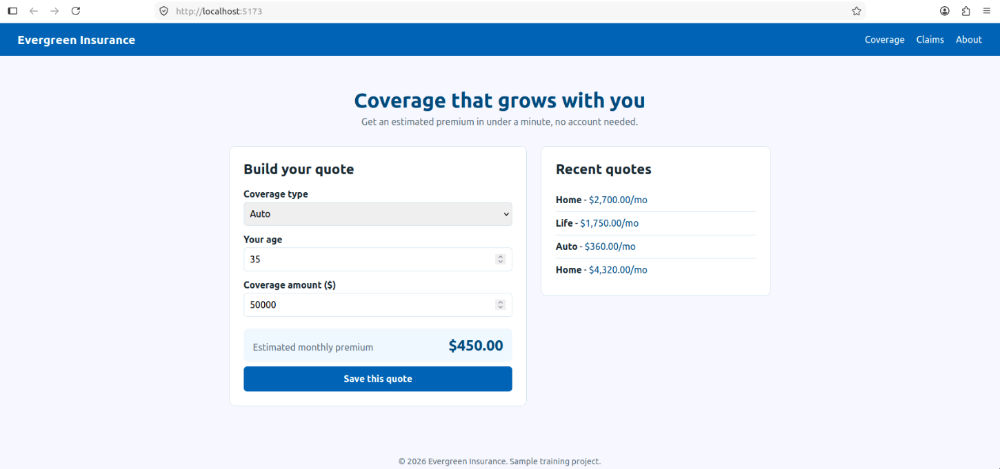
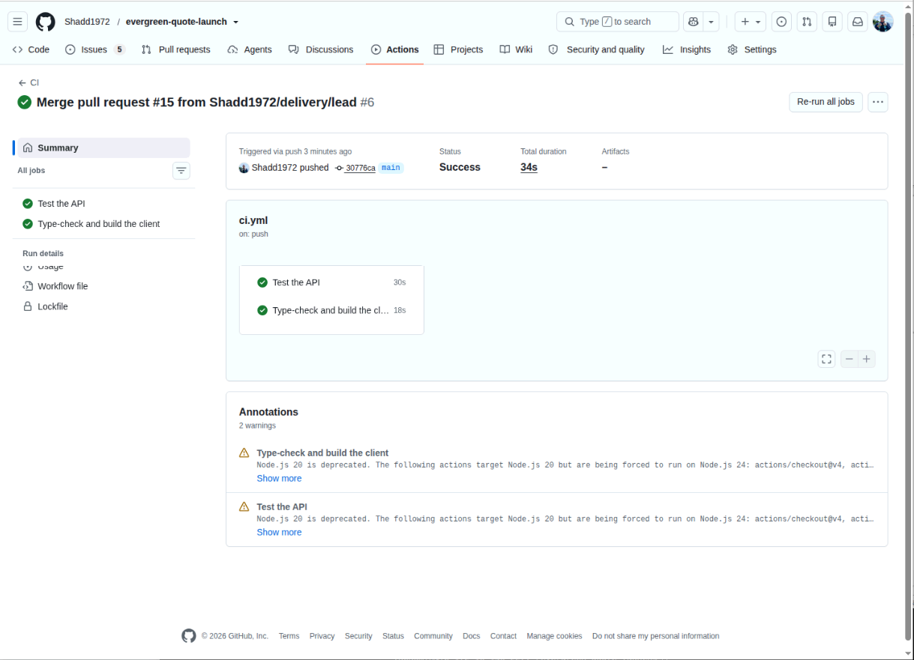

# Program Showcase: Evergreen Quote

**Presenter:** Shadd Schutte, Delivery Lead
**Date:** Friday 11-20-2026
**Format:** five slides (slides 8 to 12 of `Evergreen-Quote-Program-Showcase.pptx`), 5 minutes spoken, then 3 minutes of questions
**Audience:** cohort, sponsor, and managers who have not seen the program from the inside

## Slide 1: Delivery goal & did we hit it?

- **Goal (one sentence):** By Thursday EOD, the wired Evergreen Quote app saves quotes that survive a reload at the same premium the estimate promised, the containerized API runs as three pods on the local cluster, and the launch is merged to main through a reviewed PR with both CI jobs green.
- **Hit?** ☒ Yes  ☐ Partially  ☐ No
- **Why:** all seven done criteria were met by Thursday, and both CI jobs are green on merge commit `30776ca`.

| Done criterion | Evidence |
|---|---|
| Quotes load from the API; a saved quote survives a reload |  |
| Estimate and saved premium agree at launch rates ($450 = $450) | `screenshots/d2-06-rates-aligned.png` |
| `npm test` 7 of 7; client type-check and build pass | `screenshots/d4-02-test-7-passing.png`, `screenshots/d4-01-production-preview.png` |
| Container `evergreen-quote-api:2.0` as 3 pods behind one Service | `screenshots/d3-03-pods-running.png` |
| Landing banner set; links open the app | `screenshots/d2-08-landing-launch.png` |
| Reviewed PR merged; CI green on the merge commit | `screenshots/d4-05a-pr-merged.png`, `screenshots/d4-05b-ci-green-main.png` |
| `delivery-leadership-package/` complete and committed | This folder, on `main` |

## Slide 2: What shipped

- **The wired app:** the quote page on merged `main`, showing quotes that came from the cluster's database, with the estimate at $450.

  

- **Merged PR:** [#15 Evergreen Quote launch: client wired to the API, containerized, cluster-demonstrated](https://github.com/Shadd1972/evergreen-quote-launch/pull/15). 12 commits, 74 files, +997 / -100: HTML, CSS, TypeScript, JavaScript, a Dockerfile, YAML manifests, and a CI config in one reviewed diff. Squash-merged into `main` as `30776ca`.
- **Green two-job CI run:** [CI run #6 on `main`](https://github.com/Shadd1972/evergreen-quote-launch/actions), "Merge pull request #15 from Shadd1972/delivery/lead": **Test the API** and **Type-check and build the client** both passed (34 seconds).

  

- **Bonus (Thursday cloud window):** the same image and manifests ran on Amazon EKS in my sandbox account and served a quote over the public internet; everything was removed the same afternoon. See `cloud-verification-note.md` if written.

## Slide 3: Two key decisions

- **Decision 1:** The server is the source of truth for price; the client's rates were aligned to the API's (auto 90, home 135, life 70).
  **Why it mattered:** the same quote showed $425 on screen and saved at $450; now the customer sees the price we keep. (`decision-memo.md`)
- **Decision 2:** Split marketing's life-first ask: ship the landing content I own, route the form-default code change to the front-end team, defer renters.
  **Why it mattered:** two days before launch, "small to type" is not "small to ship"; the shared hook every estimate uses deserved its owner's review. (`memo_response_inject1.md`)

## Slide 4: Risks & injects

- **Top risk we tracked:** R2, price drift: the customer sees one price and is saved at another (likelihood H, impact H). Mitigated Tuesday by aligning the rates and verifying $450 in both places. (`risk-register.md`)
- **Inject #1 (Tue):** marketing asked to lead with life coverage and to default the form to life; renters came back. I approved and shipped the life-first hero and banner, routed the form default to the front-end team with the launch date, deferred renters, added a Deferred / Post-launch column to the board, and confirmed a fully local demo plan in writing.
- **Inject #2 (Wed):** the shared demo environment's API pods crashed after the platform team renamed `MONGODB_URI` to `MONGO_URI`. I did not touch their cluster: I routed the evidence and one question to the platform team, sent the reporting manager a holding message, verified my own cluster, manifest, and CI were green, and called **GO WITH CONDITIONS**. (`memo_response_inject2.md`, `inject2_comm.md`, `go-no-go.md`)

## Slide 5: What three phases built

- **The journey:** a static page (Phase 1), then a live, typed React app (Phase 2), then a service with a database (Phase 3), and this week one wired, containerized, orchestrated product.
- **What I take back to work on Monday:** make the call from evidence, and name which environment the evidence is about.
- **One thing I'd do differently next round:** set up the `.gitignore` and verify the environment before the first `npm install`, not after.

## Q&A prep: likely questions

| Question | Answer | Backup slide |
|---|---|---|
| The demo returned quotes all week; why does one red test matter? | The demo proves the one path I clicked; the tests prove every path, on every push, on a clean machine. A red test is the cheapest place to find a problem. | 16 |
| Why doesn't the form default to life, if marketing asked? | That half of the ask is shared code owned by the front-end team. I shipped the part I own the same day and routed the rest with the launch date. | 10 |
| Why didn't you ship renters? | It crosses two validation systems, the app's and the database's, two days before launch. It is first in line post-launch. | 10 |
| Is this running in the cloud? | Today's demo runs on a local cluster shaped like our platform. On Thursday the same image ran on Amazon EKS, then everything was removed: no ongoing cost. | 18 |
| What happens if a server crashes? | Three copies run behind one address; I deleted one on purpose and the cluster replaced it while the app kept working. | 16 |
| Was the launch at risk on Wednesday? | No. The broken environment belonged to the platform team; our cluster and checks stayed green, so I routed it and called go with conditions. | 11 |
| How did you use AI this week? | Copilot drafted two seed quotes; I reviewed every field before keeping them, because no automatic check covers that file until the seed runs. | 20 |
| What bug did the compiler catch? | The service names its id field `_id`; the app read `id`. The type-check caught it Tuesday and the fix was one line, without weakening the contract. | 15 |
