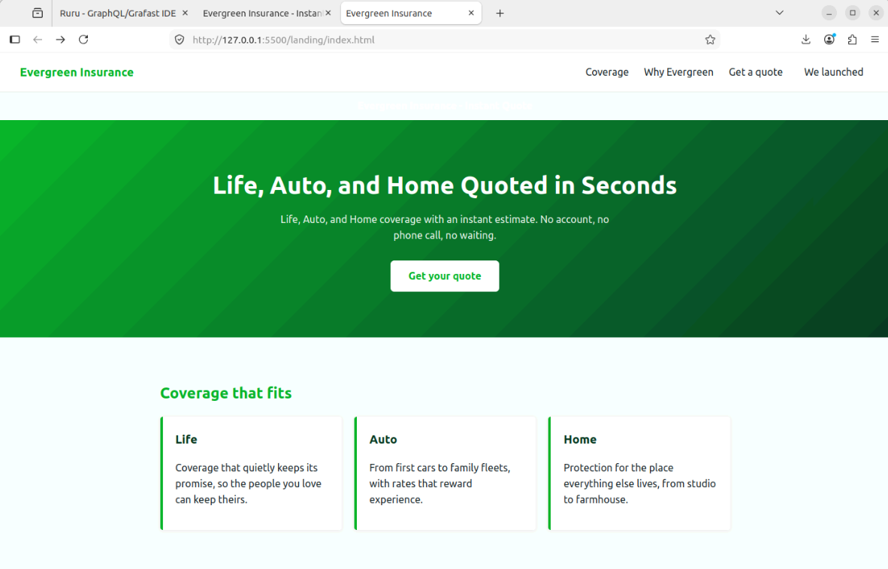
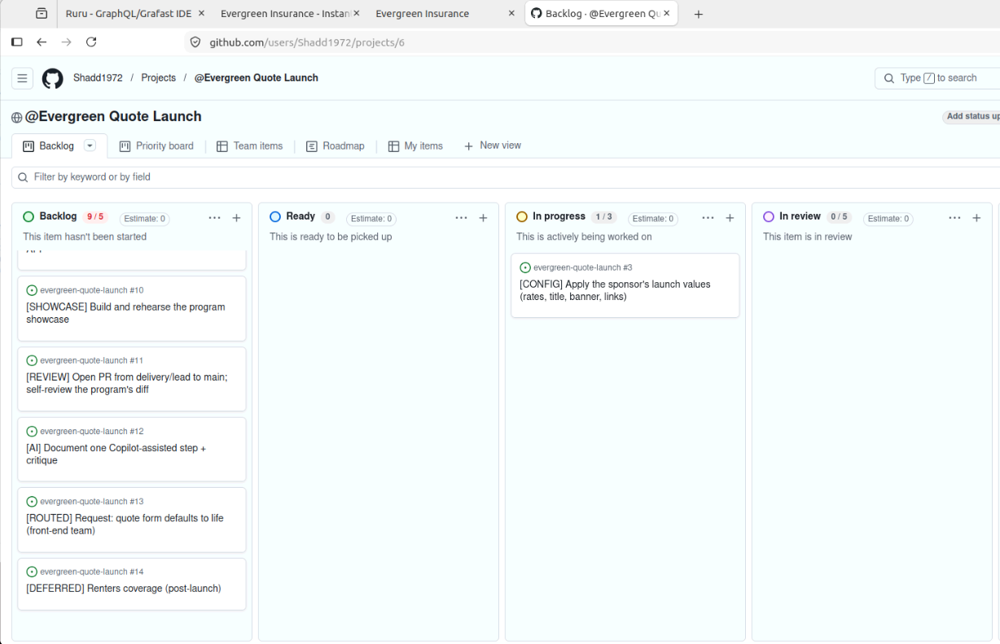

# Memo: Response to Launch Pivot (Inject #1)

| | |
|---|---|
| **To** | Priya Ramanathan, Project Sponsor |
| **From** | Shadd Schutte, Delivery Lead |
| **Date** | Tuesday 11-17-2026, EOD |
| **Re** | Life-first launch ask, renters, and Friday demo plan |

## Summary

The delivery goal is unchanged and on track. I have approved and
delivered the life-first landing change, routed the quote-form default
to its owning team, deferred renters to post-launch, and confirmed a
fully local demo plan. One decision is needed from marketing by
10:30 Wednesday.

## 1. Life-first launch ask

Marketing's request contains two separate changes, and I have handled
each according to who owns it.

| Change | Owner | Decision | Reason |
|---|---|---|---|
| Landing hero heading and banner lead with life coverage | Delivery Lead (launch content) | **Approved and done today** | Content only; no application code or tests affected. |
| Quote form defaults to life instead of auto | Front-end team (shared hook used by every estimate) | **Routed, not changed** | Two days before launch, a change to shared application code deserves the owning team's review. |

The form-default request has gone to the front-end team with Friday's
launch date attached. If they cannot review it before Thursday's
merge, it moves to the first post-launch change.

## 2. Renters coverage

**Decision: not this week.** Renters was deferred last week as scope
creep. It now crosses two validation systems, the client's type rules
and the database's, which adds risk two days before launch. It moves
to post-launch planning and is tracked on the board.

## 3. Friday demo plan

Friday's demo runs entirely on my VDE; nothing uses the cloud or the
shared demo environment.

| Piece | Plan |
|---|---|
| Where | My VDE only |
| Cluster | Local kind cluster `evergreen`: three API pods and one database pod |
| Connection | `kubectl port-forward svc/evergreen-quote-api 3000:80` |
| App | `http://localhost:5173`, opened from the landing page |
| Fallback | Screenshots of each step of the demo |

## Request

Please confirm that marketing is happy with the hero wording by
**10:30 Wednesday**.