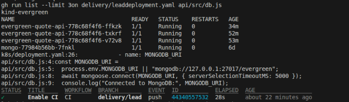

# Memo: Response to Launch Incident (Inject #2)

| | |
|---|---|
| **To** | Priya Ramanathan, Project Sponsor |
| **Cc** | Platform services team (owner, shared demo environment) |
| **From** | Shadd Schutte, Delivery Lead |
| **Date** | Wednesday 11-18-2026, 14:30 EST |
| **Re** | "Could not load recent quotes" in the shared demo environment, and Friday launch impact |

## Summary

The shared demo environment has been down since about 13:25. Its quote
service cannot reach its database after an environment-variable rename
by the platform team. This environment is owned by the platform team and
has been routed to them. Friday's launch demo does not run on it: our own
environment and our automated checks are healthy. My launch call is
**GO WITH CONDITIONS**.

## 1. What was observed

| Evidence | What it means |
|---|---|
| Three API pods in `CrashLoopBackOff`, restarts climbing, all about 30 minutes old | The quote service keeps starting, failing, and restarting. The pods are as old as the platform change. |
| `mongo` pod `1/1 Running`, 0 restarts, 6 days old | The database itself is healthy. |
| Log: `ECONNREFUSED 127.0.0.1:27017` | The service is looking for a database inside itself, not at the real database. |
| Deployment shows `MONGO_URI` | The application reads `MONGODB_URI`. After the rename, the setting is effectively missing. |

**In plain English:** the shared demo environment's quote service cannot
find its database because a setting was renamed; the database is fine.

## 2. Which environment is affected

| Environment | Owner | Status |
|---|---|---|
| Shared demo cluster | Platform services team | **Broken**: routed, tracked as risk R9 |
| My local kind cluster `evergreen` | Delivery Lead | **Healthy**: 3 API pods and 1 database pod Running |
| CI on `delivery/lead` | Delivery Lead | **Green**: both jobs passing ([run link](<paste URL>)) |
| My repo (`k8s/deployment.yaml`, `api/src/db.js`) | Delivery Lead | **Consistent**: both use `MONGODB_URI` |

Nothing customer-facing shipped from our pipeline today; nothing has
been merged.

## 3. Actions taken

- **Routed to the platform team** with the evidence and one question:
  confirm whether the rename is the cause and restore the variable name
  the application reads, with an update by 16:00.
- **Holding message sent** to the manager who reported the issue,
  confirming Friday's demo does not depend on the shared environment,
  with a next update by 16:30.
- **Did not change the shared environment.** It belongs to the platform
  team; the fix happens on their side.

## 4. Impact on Friday's launch

**Decision: GO WITH CONDITIONS.** Friday's demo runs on my own local
cluster and is proven by my CI, and both are green. The shared-environment
incident is real and tracked, but it is owned by the platform team and
nothing in our merge path depends on it.

**What would flip this to NO-GO:**
- CI on the pull request turns red, or
- the platform team finds the cause is in our image or manifests rather
  than in their environment.

## Next update

I will update you by **16:30 today**, or sooner if the platform team
restores the shared environment.