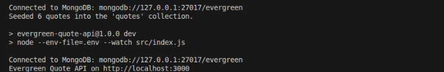
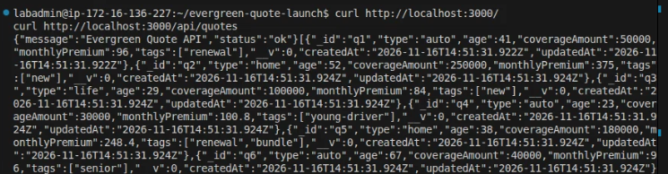
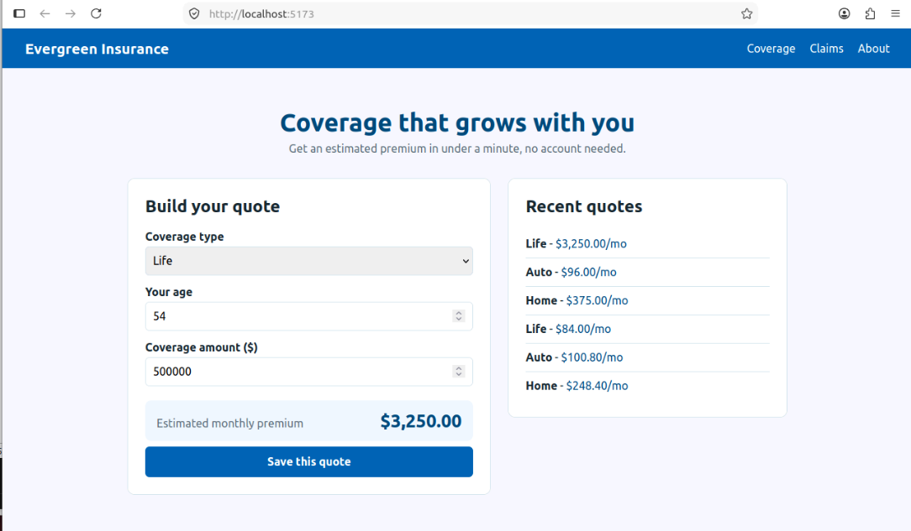
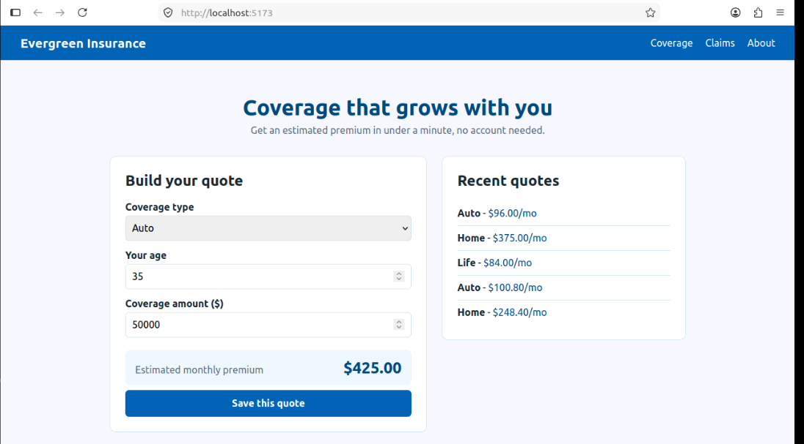
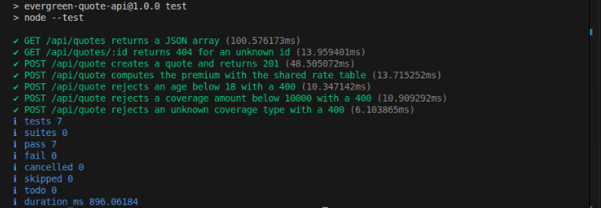

# Evergreen Quote: Vision Brief

## Product
**Name:** Evergreen Insurance Quote (the launch: full-stack delivery)
**Delivery week:** Final
**Delivery Lead:** Shadd Schutte
**Engineering team (represented by):** https://github.com/Shadd1972/evergreen-quote-launch
**GitHub Project board:** https://github.com/users/Shadd1972/projects/6

## Who is the customer?

First-time insurance shoppers: someone buying their first car, renting
their first place, or starting a family, checking prices on their phone
in a few spare minutes. They want a believable monthly number fast, with
no account and no phone call. Today their alternative is a competitor's
form that asks for an email or a callback before showing any price.
Behind them are two internal customers: the partner pilot team, who
query quotes over GraphQL, and the operations team, who need the service
containerized, tested in a pipeline, and runnable on the company's
cluster platform.

## What pain does Evergreen Quote remove?

"I got a price, but when I came back it was gone, and I'm not sure it
was even real." Today our quote page gives an instant estimate but
forgets everything on reload, and the quotes it lists are sample data
bundled into the page, not the quotes our service actually stores. The
service remembers every quote, but no customer has ever seen it.
Wiring the two together means the number a shopper sees is the number
we keep, and it is still there when they come back.

**Day 1 evidence: the gap**

| What the page shows | What the service stores |
|---|---|
|  |  |
|  |  |

## What does "good" look like at end of the week?

- A quote saved in the browser is still there after a reload, served
  from the database through the API.
- The estimate on screen and the saved premium match at the launch
  rates (auto, age 35, coverage 50000 shows $450.00 in both places).
- The API runs as the `evergreen-quote-api:2.0` container, with three
  copies on the local cluster behind one Service.
- Both CI jobs (API tests; client type-check and build) are green on
  the merged `main`.
- The landing page carries the launch banner and its "Get your quote"
  links open the app.

## What are we explicitly NOT doing this week?

- No authentication, accounts, or payments; we quote, we do not sell.
- No real rate engine and no new coverage types (renters stays on the
  wish list).
- No cloud dependency for the launch demo; Friday runs on the local
  cluster.
- No new application code or refactoring of any team's work; we
  assemble the provided pieces and route changes to the owning team.

## How will we know if it worked?

- 6 of 6 seeded quotes appear in the app, and 3 of 3 test quotes
  survive a reload with the saved premium equal to the estimate.
- 2 of 2 CI jobs green on the merge commit, and 3 of 3 API pods
  `Running` on the cluster.
- The Friday showcase lands in 5 minutes or less, with no questions
  about what the product does.

*Baseline: 7 of 7 API tests green before any change.*
